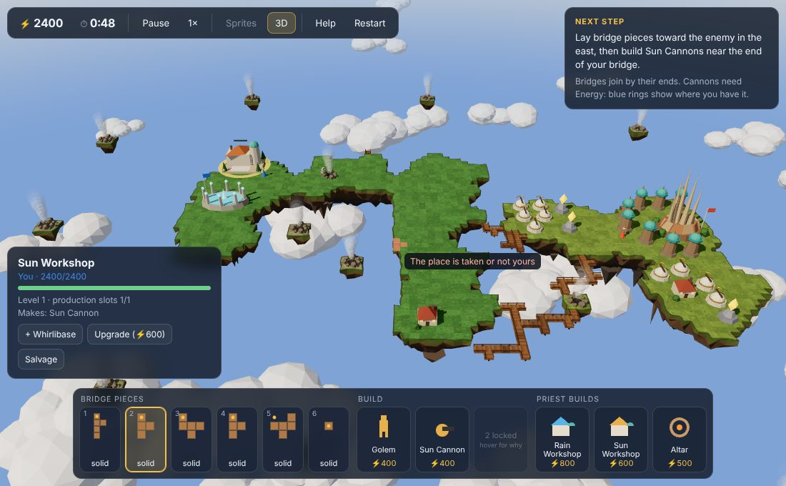
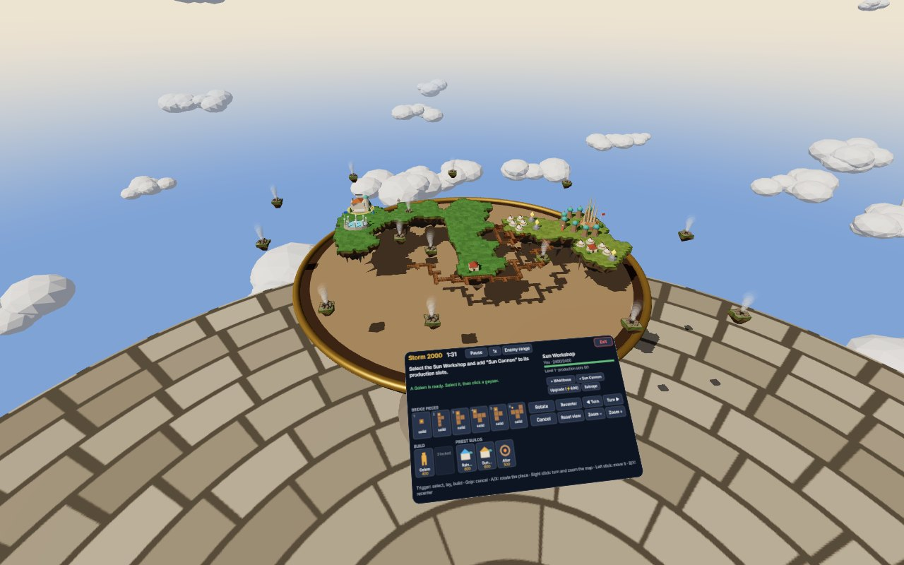

# NetStorm 3D

An A-Frame reimagining of *NetStorm: Islands At War* (1997): floating islands, bridges and Storm
Power in a 3D scene you can orbit. The rules, the missions and the computer opponent come from
[netstorm-web](https://github.com/x-ror/netstorm-web), a browser remake of the game, which this
project uses unchanged as its engine. This repository is the 3D client around it.

**Play:** https://misterclarity.github.io/netstorm-3d/



## What you can play

The main menu offers two kinds of battle against netstorm-web's computer opponent:

- **Mission 1, *The War Begins!***, guided step by step (below), at the opponent's level you
  choose (easy, normal, hard).
- **Skirmish**: a random map from a seed, with your Fury and the enemy's (Wind, Rain or Thunder),
  2 to 9 islands, the opponent's level (easy, normal, hard) and the starting Storm Power. You know
  your Fury's units (the original's alignment of that name) and the Sun's first ones; the
  computer plays an alignment drawn from the seed. New geysers rise during the battle. The same
  seed gives the same map, so a map can be replayed or shared.

In the mission:

1. Your **Priest** builds a **Sun Workshop**. Put the **Sun Cannon** into its production slots.
2. Build **Golems** at your Temple and send them to **geysers** for Storm Power.
3. Lay **bridge pieces** (they arrive in your hand over time and join only by their ends) toward
   the islets and the enemy in the east.
4. Build **Sun Cannons** where your Energy reaches. A Rain Workshop unlocks Rain Generators, which
   carry Energy further out.
5. Knock the enemy Priest out, have a Golem carry him to your **Altar**, then send your Priest to
   the Altar to perform the sacrifice.

**Energy.** Every unit needs Energy where it is built, and its card shows how much: a dot per
icon in its Fury's colour, a four-coloured dot for "any". A level-1 unit needs one icon of its own
Fury; level 2 adds one of any Fury; level 3 needs two of its own and one of any. Your Temple gives
two of its Fury, and each Generator one of its own (the Sun Generator's counts as any), to everything
in its ring. Nothing is used up. While you place a unit, each ring is drawn in its Fury's colour, the
ones that count for that spot light up, and the tip says what the spot lacks and which Generators
would make it up. `src/energy.js` works this out the way netstorm-web's rules do, and `npm run check`
compares the two over a whole map.

**Orders.** A unit answers only an order it can carry out. Before a carrier or your Priest is
sent anywhere, the same search for a way that the rules make on the next step is made at once; if
there is none (a geyser no bridge leads to, say), the unit stays silent and a toast says why.

**Auto-collect** (top bar, on unless you switch it off; kept between visits): a new Golem or air
ship goes by itself to the geyser with the shortest way, one that fewer of your carriers already
work counting as nearer, and the toast says so, or that no geyser is in its reach.

**Picking.** Air ships are clicked by their bodies, high above the ground. With a Golem, an air
ship or your Priest selected, geysers and loose crystals under the cursor come first, before a
building or unit that stands in front of them.

**The islands.** Trees, pines, bushes, rocks, flowers and grass grow on island ground, in the
greens of the Fury that holds it (`ns-decor`). They are only to look at: clicks go through them,
they keep clear of buildings, geysers, Temples and Residences, and they are cleared where something
is built. A skirmish map also gets **Residences**, the Nimbians' houses, as the original's maps and
the mission have them: one on each home island well away from its Temple, one or two on each larger
unclaimed island (`src/residences.js`). As in the original, nothing is built on them and they take
the colours of the Fury whose Temple stands on their island.

**Air ships in Sprites mode** fly at the original's height, 44 pixels up, sink lower when they
land, and cast a shadow on the ground beneath them.

If something goes wrong, a small panel says so and the game keeps running. **Help** shows which
build you are playing, and a notice offers to reload when a newer one has been published.

A *Next step* card reads the state of the battle and tells you what to do next. **How to play**
(in the top bar, the main menu and the briefings) explains the game: the goal, Storm Power,
bridges, building, fighting and capturing the enemy's Priest. **Help** in the top bar lists the
controls: orbit by dragging, pan with right-drag or Shift-drag, zoom with the
wheel or a pinch, `R` rotates pieces and cannons, `Esc` cancels, `Space` pauses. Several Golems and air ships are
selected with `Shift`-click, a double click (all of that kind on the screen) or a `Ctrl`-drag box
(`⌘`-drag on a Mac); an order then goes to all of them, spread over the cells around the one
clicked. `I` picks the next idle one. On a phone the
less-used buttons (the art style, Sound, Music, Auto-collect, Tabletop, the minimap, How to play, Help, Restart) are under
**⋯** in the top bar.

To see where you stand:

- **Reach as the game measures it.** A building in hand shows where it will fire: a cannon's
  straight line, a Disc Thrower's square, the Crossbow's arc, an air base's hunting ground.
  Enemy guns' reach shows in red while you hold a piece or a building, for the gun under the
  cursor, or all the time with `G` (*Enemy range*).
- **Bridge ends.** A piece in hand marks the ends it joins by, bright where they meet ground or
  bridge.
- **Minimap** in the top-left corner: click or drag to look there. `H` looks at your Temple, `P`
  at your Priest, `F` keeps the camera on the selected unit.
- **Event log** (`L`): what happened and when, including what was built, lost and destroyed.

Two art styles can be switched in the top bar:

- **3D**: low-poly models made for this project. Each Fury has its own look (the Sun's sandstone,
  terracotta and gold; the Wind's timber and canvas, its sails and rotors turning; the Rain's blue
  stone, ice and water; the Thunder's dark metal, copper coils and violet light), every unit its
  own model, and each carries its owner's colour: a banner, a ring round its base, a belt.
- **Sprites**: the original game's sprites as cards standing in the 3D world, with its grass
  tiles on the islands. Units are animated as netstorm-web animates them: its `slotOf()` picks
  each unit's frame on each tick (walking and turning, guns turning and firing, buildings rising,
  geysers spouting, the Priest chanting), and each frame stands on its hot spot. A unit type's
  frames load the first time one appears; its still sprite stands in meanwhile. The sprites are
  not part of this repository: the page loads them at run time from netstorm-web's repository on
  GitHub, at the commit the submodule pins. Where the page may not load images from other sites,
  the button stays off and the models are used.

**Sound and music** come from netstorm-web too, read at run time in the same way: the battle's
events (bridges laid, buildings rising and done, guns firing and shells landing, explosions, a
Priest captured, the sacrifice), units answering when you pick or order them, the wind with
far-off cries, and the original's music, the Fury tracks in turn, with a fanfare or a dirge at
the end. Sounds are louder the nearer they are to what the camera looks at, and panned to their
side of the screen. **Sound** and **Music** in the top bar turn them off; the choice is
remembered in the browser.

### On a table: VR, AR and the tabletop view

The battle can also stand on a table, about a centimetre to a cell, with a panel at the table's
edge that holds the HUD: Storm Power and time, the next step, the selected unit and its orders,
the bridge pieces and the builds, and the dialogs (the main menu, the briefing, victory and
defeat). The panel always moves round to the side of the table you are on.



- **VR** (top bar, shown when the browser has a VR headset): you stand on a paved islet of your
  own above the clouds, and the battle stands on a round war table in front of you.
- **AR** (top bar, shown on headsets with passthrough and AR phones): point at a real table or
  the floor and pull the trigger, or tap, to put the islands there. Only their shadows fall on the
  real surface.
- **Tabletop** (top bar, or `T`): the same table on the screen, played with the mouse, to see
  what a headset shows.

In VR and AR the hand controllers point with a ray:

| Control | Does |
| --- | --- |
| Trigger (or a tap on a phone) | Select, give orders, lay bridge pieces, build, press the panel's buttons, as a click does |
| Grip | Cancel, as `Esc` |
| A / X | Rotate the piece or the cannon in hand, as `R` |
| Right stick | Turn the map (left and right), zoom it (up and down) |
| Left stick | Slide the map across the table |
| B / Y | VR: put the table in front of you again. AR: move it to another surface |
| Stick press | Reset the map's turn, zoom and position |

The panel has buttons for all of these too, for hand tracking and phones. On a phone, with a
piece or a building chosen, the first tap shows where it goes and a second tap on the same spot
places it.

## Running it

You need Node.js 22 or newer.

```sh
git clone --recurse-submodules https://github.com/misterclarity/netstorm-3d
cd netstorm-3d
npm install
npm run dev        # http://localhost:8080, rebuilt as you edit
```

Already cloned without `--recurse-submodules`? Run `git submodule update --init` first.

| Command | What it does |
| --- | --- |
| `npm run dev` | Builds in watch mode and serves the page on port 8080 (set `PORT` to change it). |
| `npm run build` | Writes `dist/index.html`: one self-contained file you can open directly or host anywhere. A-Frame loads from its CDN. |
| `npm run lint` | ESLint over the client and the scripts (`eslint.config.mjs`): undefined or unused names, unreachable code, shadowed names; any warning fails it. CI runs it. |
| `npm run ai:arena` | Matches of the computer against itself or against an idle side, on skirmish maps as the menu makes them, with this game's rules: wins, minutes to win, when a Priest first falls, crystals, guns, time per move. `PAIRS=hard:easy,normal:idle SEEDS=1,2,3,4 MINUTES=30`; `TRACE=1` follows one match minute by minute with every capture event and lost carrier, `EXPLAIN=<minute>` adds side 1's reasons, `ECON=1` each side's income every five minutes; `TUNE='{"hard":{…}}'` turns a level's knobs for a trial. |
| `npm run check` | Plays the mission headless for a couple of minutes of game time (no browser), failing on any error, then compares the HUD's account of Energy (`src/energy.js`) with the rules' own answer at every site of a map, with units and Generators of every Fury and level. CI runs it. |
| `npm run ai-check` | Plays eight minutes of a skirmish at each level twice, with and without the AI worker's cache (below), and fails unless the computer makes the same moves both ways; prints how long a move takes. CI runs it. |
| `npm run playtest` | Plays the built page in headless Chromium (Playwright), failing on any page error: the mission's opening; a staged endgame, whose Victory waits for the Sacrifice to be heard out; a downed Priest captured with no Altar yet and carried there once one stands; an order the rules would refuse refused at once, without the unit answering; Auto-collect on and off; several Golems selected with a box, sent together, Shift-clicked out, cleared, an idle one picked with I and all picked with a double click; an air ship clicked by its body and sent across the island; a Golem sent to a geyser by a click on its steam; a Priest sent to a geyser while holding a crystal; five minutes of a skirmish (with its Residences and greenery); five minutes of a battle the computer plays on both sides, in both art styles and on the table, checked for any warning, any unit drawn out of place or out of step with the world, and "NaN" in the HUD; and the tabletop (with the mouse, then with faked VR controllers). Run one with `node scripts/playtest.mjs <name>`. Needs `npx playwright install chromium` once, or `CHROMIUM=/path/to/chrome` to use a Chrome you have. CI runs it. |

## How it is built

The whole scene is A-Frame: [`index.html`](index.html) declares the sky, the lights, the clouds,
the terrain, the units, the effects and the camera as entities, and `src/` registers the shader,
systems and components they use.

| Piece | Kind | Role |
| --- | --- | --- |
| `ns-game` | system | Runs the match each frame (netstorm-web's `World`, its AI in a Web Worker), turns clicks and keys into the game's commands, passes events to the HUD and effects. |
| `ns-art` | system | Loads the original sprites and animation frames (by type, as needed) and switches between the two art styles. |
| `ns-sound` | system | Sound effects and music with the Web Audio API, after netstorm-web's `sound.ts`: what plays on which event, the construction loop, the guns, the music cycle. |
| `ns-sky` | shader | The gradient sky on `<a-sky>`. |
| `orbit-rig` | component | The orbiting camera; emits `ns-tap` and `ns-hover` for the game. |
| `ns-sun` | component | Shadow settings the `light` component does not cover. |
| `ns-clouds` | component | A ring of instanced low-poly clouds (used twice, `__low` and `__high`). |
| `ns-terrain` | component | The floating islands and the bridges, rebuilt when the world's terrain changes. |
| `ns-units` / `ns-unit` | components | One `<a-entity ns-unit="id: N">` per thing in the world: model or sprite card, smooth movement, health bar. |
| `ns-residence` | component | The map's Residences. |
| `ns-effects` | component | Shells in flight, impacts, explosions, falling bridges and islets. |
| `ns-placement` | component | Bridge and building previews with the reason a spot is refused and the ends a piece joins by; the reach of guns (yours and the enemy's, `src/reach.js`), Energy rings by Fury (`src/energy.js`), selection. |
| `ns-xr` | system | The tabletop modes: scales the battlefield onto the table, the VR scenery, AR placement (A-Frame's `ar-hit-test`), the controllers' rays, sticks and buttons, the panel (`src/xr-panel.js`). |
| `ns-hand` | component | A hand's controller model (the controller components `laser-controls` sets up, without its ray) and hand tracking. |

Everything on the battlefield lives under `<a-entity id="world">` inside `<a-entity id="table">`,
in cells: on the screen both are the scene's origin; in the tabletop modes `#world` is scaled,
turned and lifted onto the table. `src/space.js` turns rays and points between the scene and the
battlefield, so that clicks, the minimap, sound and the sprite cards work the same in every mode.

The HUD (`src/hud.js`) and the minimap (`src/minimap.js`) are plain DOM over the scene. The
tabletop's panel draws the same HUD on a canvas texture: it reads the HUD's elements, and a press
on one of its buttons clicks the HUD's own. `src/models.js` holds the low-poly models. Each is
baked once built: the parts that never move are merged into a mesh per finish (their colours kept
per vertex), and models of the same kind share their shapes and merged meshes, so a battle of
fifty units is about a hundred draw calls and nothing piles up on the GPU as units come and go.

**The computer opponent** is netstorm-web's AI (`aiMove` in its `packages/sim/src/ai.ts`): rules,
not a learning system. Every few seconds of game time (in a skirmish 8 at easy, 5 at normal, 3 at
hard; a mission sets its own, which easy lengthens and hard shortens in the same proportion) it
reads the battle and gives the same kind of commands a player
does: it sends transports to geysers, lays bridge pieces toward the best free geyser and later
toward the enemy, around the cells his guns cover (except at easy), places guns and Generators at
its bridge heads, builds and fills Workshops for the Furies it knows, answers air units with
anti-air, and captures and sacrifices a downed Priest. The levels
differ in how often it moves, how much it does in a move and how much it weighs danger, not in
Storm Power or prices. Each move is worked out in a Web Worker on a copy of the world and applied
a second of game time later.

**What it costs to run.** Frames are drawn at most 60 times a second, and 15 while the battle is
paused or a dialog is open and the camera is still; a headset gets every frame. The sun's shadow
map is redrawn every other frame. In the AI's worker, netstorm-web's check of which ground is
joined to the Temple, a flood fill over the whole territory that a move repeats for every bridge
site it weighs, is kept once worked out (`scripts/ai-memo.mjs`, applied to the worker's bundle
only, where the world is a copy that never changes): a move late in a battle takes about 70 ms
instead of several hundred, and seconds at worst before. `npm run ai-check` shows the moves are
the same. A worker that stops answering is replaced; the moves never move to the page's own thread
for good.

**Where the rules differ from netstorm-web.** `scripts/house-rules.mjs` changes the simulation's
source as it is bundled, and the build fails if netstorm-web's code there has changed. A downed
enemy Priest can be picked up before you have an Altar, as the original's help describes it. The
carrier then holds him where it stands, and **Carry to the Altar** on its card sends it on once an
Altar is built. And a Transport can be sent to a place, not only for something (`moveTransport`):
"Left-click someplace legal, and the Transport will move there", as the original's help puts it.
Golems walk there; air ships fly there and land. The computer captures by the same rule: it
sends its carriers for a downed Priest before it has an Altar, and on to the Altar once it has one.
`npm run check` sets that up and fails if it does not. And a new geyser that rises where a spent one stood takes over the carriers
bound for the old one: netstorm-web left them bound for a geyser that no longer existed, and the
world's own check then refused the copies made for the computer's moves until they arrived (found
in `npm run ai:arena`).

**The computer opponent**, netstorm-web's, plays here with changes measured in
`npm run ai:arena`, each a knob of its levels (the menu sums each level up in a line). Traced matches showed why it rarely won: it paid for
a defence whenever enemy ground came near, fired on or not, and the guns it wanted at the enemy
Priest were never paid for; a Priest it knocked out got up again before a carrier came; and the
carriers it sent walked through his guns and died. Now **Hard puts the assault first** (no defence
for ground that merely comes near while its guns are wanted at the enemy and nothing of its own is
fired on); **carriers wait** at the nearest safe ground by an enemy Priest under fire (Normal one,
Hard two), to take him the moment he falls; and **Normal and Hard send no carrier on a way through
more fire than it would survive**. Later traces added more: **Easy defends only once it is fired
on** or loses something, not whenever enemy ground comes near (it had walled itself in with as many
guns as Hard); **Normal and Hard keep their Priest safe**, with Outposts on the free ground nearest
the Temple, an idle Priest walked home and no geyser for him beyond 24 cells (Hard's had walked 100
cells out and lain knocked out for twenty minutes); **Hard lays no Generator ahead of its guns while
it has three more Generators than guns** (sides had 25 to 37 to 5 to 11 guns; Normal, slower to
lay its guns, came later to the enemy without them, so it keeps them);
**Normal and Hard lay their next bridge piece to a downed Priest** no ground of theirs leads to
(Hard had knocked Easy's out seven cells from its bridge, and he lay there a minute);
**Hard fetches a downed Priest by air** where no bridge of its leads, and buys a flying carrier
once that happens; where every carrier Normal or Hard has would die on the way to a downed Priest,
it buys (saving up, and salvaging a spare gun) the cheapest that would live through it, a Sail
Skater where Golems fall; carriers also wait while the enemy Temple is under fire, since its fall knocks
the Priest out; at every level a side left with no carrier and too little Storm Power for one
salvages a spare gun for it; **Normal and Hard
mine with their swiftest carriers**: the first Workshop slot of its Fury goes to a carrier half as
fast again as a Golem, they save up for it and trade Golems for it (Hard, playing Wind, had carried
with Golems all battle, never its Sail Skaters, and its income fell from 34 crystals in the first
five minutes to 4 to 7 as its geysers came to lie 60 to 110 cells away; now it brings 42 in the
second five minutes); two carriers always keep mining while others wait by an enemy Priest, and
none waits for two minutes after one that waited is shot (Hard had lost all four Sail Skaters so);
a carrier fetches a loose crystal only if it would live to bring it home (one
killed under the enemy's guns dropped its crystal there, the next walked in for it and died, a
carrier lost every minute and a half on both sides for fifteen minutes); and a gun short of
Energy at a bridge head that already has some gets
one more Generator there, up to three (this game's Energy counts icons, and the opponent only ever
laid a Generator where there was no Energy at all: Normal stood six cells from an idle enemy's
Temple for four minutes with 1500 Storm Power). `npm run check` checks the carriers in wait. A Priest sent to a geyser works that one
alone: when it is spent he stops and waits for orders, where netstorm-web walks him on to the
geyser nearest his Temple, which can take him to the front. Golems and air ships still move on.

**netstorm-web** sits in `vendor/netstorm-web` as a git submodule pinned to one commit. The build
bundles its TypeScript straight from there (`src/engine.js` lists what is used: the simulation,
the mission set-up, the mission script's events, the AI schedule and worker). Its client's
compiled interface strings are replaced by `src/messages.js`, which reads its English messages
file. To follow netstorm-web, update the submodule and rebuild:

```sh
git -C vendor/netstorm-web pull origin main
npm run check && npm run build
git add vendor/netstorm-web && git commit -m "Update netstorm-web"
```

Moving the pinned commit also moves the URLs the original sprites, sounds and music are read
from (`scripts/make-data.js` writes them to `build/art.json` and `build/sounds.json`).

**Deploying:** [`.github/workflows/pages.yml`](.github/workflows/pages.yml) runs the check, builds
`dist/` and publishes it to GitHub Pages on every push to `main`. Pages has to be set to deploy
from GitHub Actions once (*Settings → Pages → Source: GitHub Actions*).

## Not there yet

- Only the first mission of the campaign; the engine has the other fifteen. Skirmish has no
  spells or Obelisks yet.
- In "Sprites" mode the overlays the original lays over some units (a Temple's whirl, a
  cannon's charge) and the units' shadows are not drawn yet.
- Tested in desktop Chromium; phones and other browsers are less tried. The VR and AR modes
  follow the WebXR standard and A-Frame's controller support, and the playtest drives them with
  faked controllers, but they have not been tried on a real headset or phone yet.

## Credits and legal

- *NetStorm: Islands At War* © 1997 Titanic Entertainment / Activision. This is a non-commercial
  fan project, not affiliated with them. The original sprites, sounds and music are not in this
  repository; the page reads them from netstorm-web's repository when it runs.
- [netstorm-web](https://github.com/x-ror/netstorm-web) by x-ror: the simulation, the missions,
  the computer opponent and the sound design this client follows. It is included as a submodule under its own terms; it has no LICENSE
  file, and its `package.json` declares ISC. The built page (`dist/index.html`) contains its code.
- The code in this repository is licensed under the GNU General Public License v3.0
  (see [LICENSE](LICENSE)).
- Built with [A-Frame](https://aframe.io) 1.8 and three.js.
