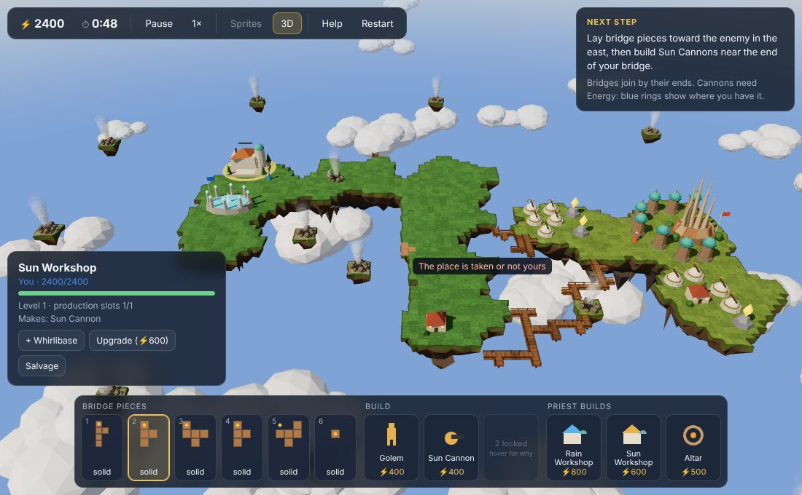
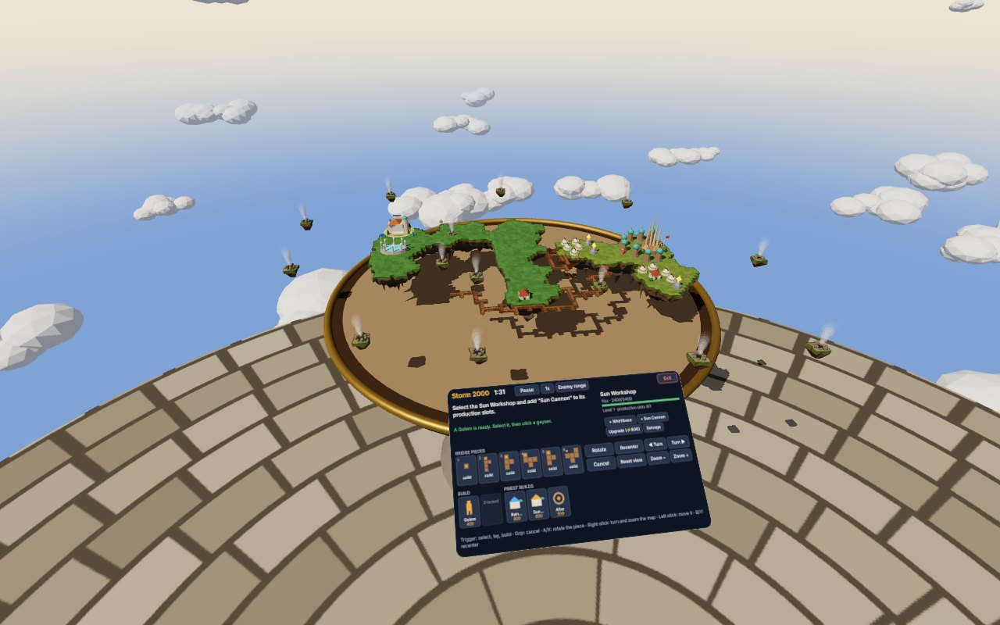

# NetStorm 3D

An A-Frame reimagining of *NetStorm: Islands At War* (1997): floating islands, bridges and Storm
Power in a 3D scene you can orbit. The rules, the missions and the computer opponent come from
[netstorm-web](https://github.com/x-ror/netstorm-web), a browser remake of the game, which this
project uses unchanged as its engine. This repository is the 3D client around it.

**Play:** https://misterclarity.github.io/netstorm-3d/



## What you can play

The main menu offers two kinds of battle against netstorm-web's computer opponent, and a
campaign of its own:

- **Mission 1, *The War Begins!***, guided step by step (below), at the opponent's level you
  choose (easy, normal, hard).
- **The Combahee Raid**: two battles and an epilogue in NetStorm's own world, a fantasy after
  the Combahee River Raid of 1863 and Thea Anderson's essay on its Mercurial guide (below). Your
  High Priest is **the Wayfinder**, born under Mercury: swift and hard to catch, he reads the
  signs about him, slips by in disguise and moves by night, and he lives to guide and shield those
  who cannot fend for themselves. Between two chains of islands runs the Combahee, a wind the
  airships ride. In *Sky Messages*, under a new moon, he walks both chains to the quarters of the
  Sun-lords' four estates, whose bondfolk tell him where the sky mines float, and on to his
  scouts' cove before dawn: sentries fire on him within a reach that is shorter in the dark, a
  flock of birds rises over one before it can see him, and his **disguise** (<kbd>C</kbd>) keeps
  every sentry from firing for 15 s. In *The Combahee Wind*, under the full moon, the airships
  Swallow and Rainbird ride the wind past the mines he found; a ship tied up at a landing sounds
  its horn, and the bondfolk of that estate walk down to it family by family, with their bundles,
  pots and animals, and are rowed out to it by skiffs (two landings are cut off by a rift until
  you lay bridge). The first estate watches the strange ship a while before anyone runs for it;
  a warden at each quarters halves the pace they leave at until the volunteers a horn sends up,
  or the Wayfinder himself, run him off; a crowd too big for the skiffs clings to them and
  boards at half pace until he sings there (his song doubles the pace). Sentries who see a ship
  send riders with the alarm, and two bring the Sun-lords' battery sooner; it must not cross
  their bridge at Ferry Isle before it burns (a bonus), and past the burned bridge, stakes across
  the wind stop the ships. The ships' guns can burn the Sun-lords' three mills (another bonus),
  and the ships must be home by midday with enough people aboard. The second battle opens once the first
  is won (the menu remembers it, and the mines found). Each battle lists its objectives, in its
  briefing and on the panel at the right as you play (✓ done, ▸ the one to work on, ✗ failed),
  with the next step spelled out under them and a marker over each place they name. Easy, normal
  or hard. Nobody is captured
  or sacrificed in this campaign, and the people who free themselves are no units: no gun aims
  at them, and they are counted only by the ships that take them aboard.
- **Sky cities** (the main menu): two demo maps with no battle, built to be walked through your
  Priest's eyes (**V**), with low-poly houses, stalls, trees and towers made for them standing in
  the way. **Concord** is the trading city of the four Furies: a quarter each, built its own way
  (the Sun's of sandstone under awnings and sun discs, the Rain's of pale stone under blue vaults,
  the Wind's of whitewash and timber under green gables, the Thunder's of slate under steep roofs
  and lightning rods), each round a market square with its landmark (a sundial, a fountain, a wind
  tower, a coil) and its Fury's Temple at the end of its avenue, and bridges from all four to the
  Temple of Concord on its compass rose. **Altamar** is a terraced city of whitewashed houses, blue
  domes, roof pergolas and hanging vines on islands at three heights: a domed hall and its bell
  tower above, the town of lanes, a fountain square and windmills in the middle, the harbour with
  its warehouses, stalls and piers below, and a garden on an islet off each end of the town, joined
  by bridges and the lifts between the levels. Townsfolk stroll the streets, the airships of the
  Furies wait at the docks, and night falls after a minute and a half: the lamps and windows light
  up under a full moon. The panel at the right lists the city's sights, ticked as he reaches each,
  with the way to the next (and a gold marker over it); his eyes say how far and which way. Nothing
  is built, laid or prayed for there, and nobody wins: the rules (`sim/city-map.ts`) refuse all but
  walking, by order or by hand.
- **Tower defense: The Bridges of Nimbus** (the main menu): a campaign of six battles against
  the Hollow Priest's horde, on a campaign map of its own, each battle opened by winning the one
  before and given up to three stars for the lives kept (kept in the browser). The horde marches
  out of storm gates along the bridges to your Temple: the game's own walkers (Golems, Fire Ants,
  Crystal Crabs that steal Storm Power, Sail Skaters, three-life Bulfs and Old Thunderhide) and,
  over them, its airships (Balloons, Cloud Floaters that half the shots pass through, Air Ships,
  and the Hollow Priest's flagship, which holds the guns about it still). You hold it off with
  the game's own guns, raised on stone platforms beside the bridges with the Storm Power each one
  brought down pays, each to three ranks (hits ×1.5 and ×2.2, a cell more reach each), turned
  or sold: the Disc Thrower and the Crossbow, the Ice Cannon whose shells chill walkers, the
  Vander Tower at the air, the Sun Cannon turning to the best of its four lines, pairs of Arc
  Spires at Arc gates whose band shocks all who cross the bridge, the Thunder Cannon, and the Man
  o' War Pool. They fight as the rules have them: a cannon down one straight line (so raise it in
  line with a bridge), the Crossbow into its arc, the archers about them; menus show a gun's reach
  as you point at it. Call the next wave early for Storm Power (N), and cast Thunder Strike (1) and
  Paralysis (2). The battles, the campaign and its story are made up for this game.
- **Skirmish**: a random map from a seed, with your Fury and the enemy's (Wind, Rain or Thunder),
  2 to 9 islands, the opponent's level (easy, normal, hard) and the starting Storm Power. You know
  your Fury's units (the original's alignment of that name) and the Sun's first ones; the
  computer plays an alignment drawn from the seed. New geysers rise during the battle. The same
  seed gives the same map, so a map can be replayed or shared.
- **Spells**, in a skirmish as in the original's multiplayer battles. The Priest's card offers his
  prayer for the **Devastation** (40 s standing still; walking or a hit breaks it off); then he
  holds it, an orb glowing over his head, and his card casts it round him for ⚡100, five seconds
  later: everything on the ground within 3 cells is destroyed, the caster's own too, Temples and
  Workshops lose a third, and bridges there fall. Selected, he shows the ring it will reach; a
  caster casting shows it pulsing, the enemy's too. The skirmish's **Spells** setting adds the
  original's other ways: **Obelisks** (Spells rise on Obelisks during the battle; a carrier sent
  to one takes its Spell and casts it from its card; the Devastation is still prayed for) or **Any,
  by prayer** (the Priest prays for any but the Thunder ones). Each Spell's blast is drawn: a fireball, bolts from the sky,
  falling rocks, a ring of its colour. How to play lists every Spell: what it does, its cost,
  reach, cast time and prayer. The computer prays and casts by the same rules, by its level (below).
- **Heights** (a skirmish setting, *Level* or *Tiered*): with *Tiered* the islands stand on three
  levels, a middle one and one below and one above it, 8 cells apart, so that a bridge across
  the usual gap would have to climb at 30 to 45 degrees; at Easy and Normal both home islands
  start on the middle level, at Hard where they lie decides, and there is always an island above
  and one below. Bridges are laid flat on a level: yours on the one shown by your bridge pieces
  (**Q** a level down, **E** up; the camera follows, and a faint grid shows the level under the
  piece), the computer's on the level of what the piece joins. While you hold a piece, markers
  float over the open ends of your bridges, and the piece **snaps** one of its ends onto the open
  end (or the rim of your ground) nearest the pointer, measured where the pointer is at that
  end's own height, so you point at the end you see; turned as you turned it (R) if it fits so. Where a bridge joins ground or bridge of another level a **lift**
  stands, and the preview marks those ends blue. A walker crossing rides it: two seconds a level,
  whatever its pace. A lift stands as a **building**: its car takes every hit on those riding it,
  who take none, and it has 400 hit points (a bar over it once it is hit); spent, it **bursts**, the
  bridge it hangs from falls with the carriers in its car (a captive set down on the ground by it),
  and a Priest in it is thrown onto that ground, knocked out. Nobody stays in a lift (a ride
  always ends on a cell; an order to stop sets the rider back where he got on), so the car is
  cover for a crossing under fire, worn down by every one, and a lift under enemy guns is a place
  to cross quickly, to defend, or to bring down. Reach goes up and down
  too: flyers hunt in a **sphere** about their base, as far up and down as across (a
  Whirlibase's Whirligigs reach another level as far as their sphere cuts it, and their circles
  on the other levels show while you place one), and the **Sun Disc Thrower** throws level or
  upward in a half sphere of its range, never down: it cannot hit what stands below it, but hits
  a walker riding a lift up past it. Other guns reach as on one level. An islet laid off a
  bridge's end is on that bridge's level; a geyser's islet that rises in the sky on a level of
  its own. What flies keeps to the height of the land round about; everything else stands on its
  level, and clicks find the island or bridge under the cursor. The rules are in
  `scripts/house-rules.mjs` (the world's `level` of each cell, lifts in movement and combat), the
  drawing and the levels' choice in `src/heights.js`.
- **Fog of war** (Settings, in the main menu: on unless turned off; taken by each game as it
  starts). A battle begins with only your home island explored, and the islets just off its shore;
  the rest of the islands lie under a dark grey haze, as in an RTS, and what stands or moves on
  ground or sky you have not explored (the enemy's Temple and guns, his carriers and flyers,
  geysers, crystals, bridges, Residences, trees) is not drawn, not on the minimap (grey there too),
  not under the pointer, not clicked and not in the enemy's reach (`G`); a new carrier goes by
  itself only to a geyser you know. The haze thins away, soft at its edges, wherever something of
  yours comes within sight: a Priest 9 cells, a Golem 7, an air ship 10, a flyer 8, a building 5
  past its edge, each cell of your bridges 3; and what you have explored stays in view for the
  battle. A gun that fires on yours is seen, and the ground where your shot lands. In the Combahee
  Raid the scouting begins at Windgate alone, and the raid with the estates known from it. The fog
  is your view only: the rules and the computer opponent see everything as before. The rules of
  sight are `src/fog.js`, the haze `src/components/ns-fog.js` (a shader over a texture of what is
  explored).
- **Day and night** (Settings, in the main menu; kept in the browser, and taken by each game as
  it starts): a day of 4 minutes from the start of the battle, then a night of 2, and so on. At
  night every gun reaches less far, by the share chosen (**−25%** by default; none, −10%, −40% or
  −50%), rounded and never under a cell, and the rings show it; and a **Sacrifice waits for the
  sun** (the Priest calls out to it): his runes stop at nightfall and go on at dawn, the captive
  still chained, which leaves the night to the other side to break the Altar and free him. The
  sky fades to a night of stars and a moon over 24 seconds before nightfall, the sun to moonlight,
  and back before dawn; the clock by the Storm Power says which it is and how long until it turns,
  and the log says when it does. Off, it is always day, as in the original. The rules are in
  `scripts/house-rules.mjs`, the settings in `src/settings.js`, the light in `ns-sun.js`.
- **The moon and the Furies** (with day and night on). The nights have a moon, a phase each: the
  first night a 🌑 new moon, then 🌓 first quarter, 🌕 full, 🌗 third quarter, and new again; the
  sky draws it in its phase, the moonlight is dimmer under a new moon and brighter under the full,
  and the clock shows it. The share set in Settings is what a gun loses under a new moon; a
  quarter moon takes three quarters of it, the full moon half. The Sun's guns lose 0.6 of the
  share more; Thunder's lose nothing (they see by their own lightning); a gun in the Energy ring
  of its side's Temple or Generator is lit and loses nothing; a Vander Tower's beam lights up the
  flyers in its reach for every gun of its side. **Rain is the moon's Fury** (in astrology Cancer,
  the moon's own sign, is a water sign): its guns and flyers hit ×0.9 under a new moon, ×1.1 under
  a quarter and ×1.25 under the full moon. **The Sun's hit ×1.15 by day**; at night a Sun
  Generator is dark (no Energy) and Whirligigs stay in their base until dawn. A Priest heals half
  as fast again by day and prays a quarter slower at night, when Thunder's Spells come a third
  faster. A crystal brought home at night is worth a quarter more. The computer plays by the same
  rules: the copy of the world it works its moves out on now carries the hour and the levels of
  tiered islands, which netstorm-web's snapshot leaves out (at night it would have laid what only a
  dark Sun Generator could give Energy for, and been refused).
- **Your Priest's eyes** (first person): **V**, or **Eyes** by the minimap, takes the Priest over
  and shows the battle from his eyes, and again goes back to the view from above. **W A S D**
  walk him the way he looks, the mouse looks about (a click locks the pointer to the view, Esc
  frees it), and a crosshair points at what he acts on: a click (or **E**) there does what a click
  of the view above does with him selected (a geyser to collect, a crystal to fetch, his Altar for
  the Sacrifice, ground to walk to), or lays what the mouse wheel or **Tab** picks among his Priest
  builds, its near edge at the crosshair; bridge pieces (1 to 6) are laid there too. **Q** casts
  the Spell he holds round him, **R** prays (Shift+R picks the prayer), **B** banks the crystal he
  holds, **X** drops it. A panel under the crosshair shows his health, his prayer or Spell and
  the keys; his own figure is out of the way, but the runes at his feet as he prays are not. He
  is **walked by hand** by the rules (`steerPriest`): keys and mouse together, at any angle, at
  his pace, sliding along what he cannot step onto (the island's rim, buildings, geysers, and in
  first person trees and the Residences' houses too), stopping dead where he is when the keys are
  let go. He stands anywhere in his cell, to a thousandth of it. The order goes in the moment
  the keys change, with the share of the tick it came at, and the view draws him each frame where
  the rules' own step (`walkStep`) will put him, so the camera answers the keys at once with no
  glide, and a battle in first person is the same battle for the replay and the computer. A step
  onto another level is a ride on the lift; an order from above walks him by the grid again. This
  is the ground for exploring dungeons through cave mouths on the islands' sides: the first
  person's `place` (`src/systems/ns-fp.js`: how he is steered, where the rules will have him) is
  the islands' now, and a dungeon can bring its own while the view, the crosshair and his actions
  stay as they are.
- **The dungeon** (a skirmish's). The starting island has a dungeon under it, laid out from the
  map's seed (`digDungeon` in `scripts/house-rules.mjs`): a stone portal on the island (nothing is
  built on it, no tree grows by it), and below, rooms of rock along passages, each of its kind
  (an entry hall, a crystal cave, a hall of pillars, a pool, a grotto, a shrine, an ember cave),
  and three chests: the one farthest from the stairs holds a Spell, the rest are empty for now.
  Beside the portal, in the Priest's eyes, **E** takes him down (or "Go down into the dungeon" on
  his card); below he is walked by hand as on the surface, in the dungeon's tiles, and **E** opens
  the chest he stands by (a Spell displaces the one he held, as an Obelisk's does) or climbs the
  stairs out, onto the cell he went down from. Below, nothing reaches him, but he neither casts
  nor prays, and so that the deep is no place to hide from the war its air is heavy: after three
  minutes he climbs out by himself, and he may go down again only after 20 s.
  The rooms are ragged caves, not chambers: blobs about their middles, passages that widen here
  and there, columns standing where they will. `src/components/ns-dungeon.js` dresses it as
  caves nobody built: raw rock walls that lean and bulge, low uneven vaults hung with stalactites,
  rubble, rough columns where floor and vault have grown together; rough steps up to a doorway of
  daylight (moonlight at night); crystals; threads of glow-worms; a still pool; glowing
  mushrooms, roots and fireflies; a slab under a beam from a crack in the vault, standing stones
  about it; a floor cracked with fire; and what the dark keeps: eyes in the walls that are gone
  when he comes near, glyphs that hang in the air and wake as he passes, old bones, drifting
  wisps. It is drawn cheaply: **two real lights** (the Priest's own, which casts the shadows and
  takes the tone of the cave he is in, and the daylight at the stairs; everything else that shines
  is glow), plain matte stone, and the dungeon cut into chunks of instanced rock of which only
  those within his light are drawn: past 16 units the dark has everything. The dungeon is drawn
  far below the sea of clouds and shown, the islands, sky and clouds put away, while the player
  looks through the eyes of a Priest down in it. Every Priest also carries a **light at night**.
  Islands of their own with harder dungeons, entered from the side or from the layer below, are
  to come: a dungeon's `side` says from where.
- **What the dungeons give and take.** Every side's island has a dungeon, and a **tunnel** in
  the deepest cave of each leads to the next one's. **Chests**: a Spell; Storm Power; the **key**
  of the red **vault** (a relic that makes one Fury's guns hit ×1.25 for three minutes, and Storm
  Power); the moon's blue chest, which opens only at night; all filled again at each new moon.
  **Things** (each glows; E uses it): a pocket of **air** (the deep's time over again), a
  **shrine** (a boon that stays: a ward of 20, a Hover twice as long, a minute more air), a great
  **crystal** (at night it charges the Spell he holds: its next casting is free), the geysers'
  **valve** (the island's owner mines half as much again for 120 s; shut by a foe, half), the
  **roots of the Generators** (a foe's charge puts them out for 90 s). **Pits** in two passages
  only the Hover crosses (spent over one, he falls and is washed back to the stairs). **Lurkers**
  sleep in the far caves and come for his light from 7 tiles (2.5 with the light shaded, **L**);
  a bite takes 18, and below half his health he is dragged out. Climbing out, he comes up by the
  portal of the dungeon he is in, so the tunnel is a way onto the enemy's island.
  **A charge under the Altar:** while a Priest is chained to an Altar, a Golem of his side that
  stands 20 s beside the portal on the Altar's island sets a charge under it: the rite is broken,
  the Altar loses half its strength, and the captive is thrown clear, free but knocked out. The
  computer does not go underground, so two Priests never meet below.
- **The Sacrifice, seen and heard.** Five runes stand about the captive; the Priest performing it
  turns to the one he is warding, staff raised, a beam on it; it shrinks and is gone with a
  sound, one rune fewer each time.
- **The Hover.** A Priest prays for it (**H** in his eyes, or his card): 12 s standing still, a
  step breaks the prayer off. Then he has 30 s of it: holding **Shift** in his eyes (or "Hover"
  on his card) he floats a hand above the ground and goes 1.8 times his pace, on the islands and
  below, by hand or by the grid. It runs down only while he moves; spent, he prays again.
- **Cover** (always). A shot at a unit on the ground is taken by what stands between it and the
  gun within 3 cells of the unit: a building of anyone (a building of the gun's enemy takes the
  hit), a tree, or a Residence's house (which stop it). Guns do not aim at a unit in cover. A gun
  a level or more above the unit fires down over cover, and flyers and Spells strike from above.
  The trees are the rules' own (`treeGrows`, `treeAt`), and the islands draw them where the rules
  put them, so what you see is what covers: in the rules a tree is the cell its trunk stands on,
  though its crown, drawn twice the first size like the bushes', reaches over the cells about it.
- **The weight of a hit** (always). The Sun and Thunder Cannons are **siege guns**: ×1.5 on
  buildings, ×0.5 on units. The Crossbow, the Disc Thrower and the Ice Cannon are **light guns**:
  ×0.75 on buildings. A hit on a walker riding a lift is the lift's, a building's. On tiered islands a gun hits 20% harder for each level its target stands below it and 20%
  softer for each above (not at flyers, nor the Disc Thrower's discs), and reaches 10% farther for
  each level down, which its rings show at the levels below. A **Priest's ward**: no single hit of
  a gun or flyer takes more than 35 off him, so no one shot knocks him out (a Sun Cannon's first
  shot carried 80, a Thunder Cannon's 145, against the 50 he can lose). Select a gun and point at
  an enemy: the tip says what its hits are multiplied by.

In the mission:

1. Your **Priest** builds a **Sun Workshop**. Put the **Sun Cannon** into its production slots.
2. Build **Golems** at your Temple and send them to **geysers** for Storm Power.
3. Lay **bridge pieces** (they arrive in your hand over time and join only by their ends) toward
   the islets and the enemy in the east.
4. Build **Sun Cannons** where your Energy reaches. A Rain Workshop unlocks Rain Generators, which
   carry Energy further out.
5. Knock the enemy Priest out, have a Golem carry him to your **Altar**, then send your Priest to
   the Altar to perform the sacrifice.

**Energy.** Every unit needs Energy where it is built, and its card shows how much: a dot per
icon in its Fury's colour, a four-coloured dot for "any". A level-1 unit needs one icon of its own
Fury; level 2 adds one of any Fury; level 3 needs two of its own and one of any. Your Temple gives
two of its Fury, and each Generator one of its own (the Sun Generator's counts as any), to everything
in its ring. Nothing is used up. While you place a unit, each ring is drawn in its Fury's colour, the
ones that count for that spot light up, and the tip says what the spot lacks and which Generators
would make it up. `src/energy.js` works this out the way netstorm-web's rules do, and `npm run check`
compares the two over a whole map.

**Orders.** A unit answers only an order it can carry out. Before a carrier or your Priest is
sent anywhere, the same search for a way that the rules make on the next step is made at once; if
there is none (a geyser no bridge leads to, say), the unit stays silent and a toast says why.

**Auto-collect** (top bar, on unless you switch it off; kept between visits): a new Golem or air
ship goes by itself to the geyser with the shortest way, one that fewer of your carriers already
work counting as nearer, and the toast says so, or that no geyser is in its reach.

**Picking.** Air ships are clicked by their bodies, high above the ground. With a Golem, an air
ship or your Priest selected, geysers and loose crystals under the cursor come first, before a
building or unit that stands in front of them.

**The islands.** Trees, pines, bushes, rocks, flowers and grass grow on island ground, in the
greens of the Fury that holds it (`ns-decor`). They are only to look at: clicks go through them,
they keep clear of buildings, geysers, Temples and Residences, and they are cleared where something
is built. A skirmish map also gets **Residences**, the Nimbians' houses, as the original's maps and
the mission have them: one on each home island well away from its Temple, one or two on each larger
unclaimed island (`src/residences.js`). As in the original, nothing is built on them and they take
the colours of the Fury whose Temple stands on their island.

**Air ships in Sprites mode** fly at the original's height, 44 pixels up, sink lower when they
land, and cast a shadow on the ground beneath them.

If something goes wrong, a small panel says so and the game keeps running. **Help** shows which
build you are playing, and a notice offers to reload when a newer one has been published.

An *Objectives* card reads the state of the battle: it lists the battle's objectives (build a
Workshop, Storm Power from geysers, bridge and guns in reach of the enemy Priest, an Altar, his
capture and his sacrifice; ✓ done, ▸ the one to work on) and, under them, tells you what to do
next. **How to play**
(in the top bar, the main menu and the briefings) explains the game: the goal, Storm Power,
bridges, building, fighting and capturing the enemy's Priest. **Help** in the top bar lists the
controls: orbit by dragging, pan with right-drag or Shift-drag, zoom with the
wheel or a pinch, `R` rotates pieces and cannons, `Esc` cancels, `Space` pauses. Several Golems and air ships are
selected with `Shift`-click, a double click (all of that kind on the screen) or a `Ctrl`-drag box
(`⌘`-drag on a Mac); an order then goes to all of them, spread over the cells around the one
clicked. `I` picks the next idle one. On a phone the
less-used buttons (the art style, Sound, Music, Auto-collect, Tabletop, the minimap, How to play, Help, Restart) are under
**⋯** in the top bar.

To see where you stand:

- **Reach as the game measures it.** A building in hand shows where it will fire: a cannon's
  straight line, a Disc Thrower's square, the Crossbow's arc, an air base's hunting ground.
  Enemy guns' reach shows in red while you hold a piece or a building, for the gun under the
  cursor, or all the time with `G` (*Enemy range*).
- **Bridge ends.** A piece in hand marks the ends it joins by, bright where they meet ground or
  bridge.
- **Minimap** in the top-left corner: click or drag to look there. `H` looks at your Temple, `P`
  at your Priest, `F` keeps the camera on the selected unit.
- **Event log** (`L`): what happened and when, including what was built, lost and destroyed.

Two art styles can be switched in the top bar:

- **3D**: low-poly models made for this project, each after its sprite in the original and drawn
  as a piece of fantasy. Each Fury has its own look (the Sun's sandstone, terracotta, bronze and
  gold; the Wind's timber and canvas, its sails and rotors turning; the Rain's blue stone, ice,
  glass and water; the Thunder's dark metal, red brick, copper and violet light), every unit its
  own model, and each carries its owner's colour: a banner, a ring round its base, a belt. Most
  of them are alive when idle: the Thunder Temple is a dark glass dome in a crown of thorned
  tendrils with lightning leaping from their tips, the Rain Temple a carved ring round a glowing
  pool with fountains at its rim and a great drop of water ringed by turning streams over it, the
  Fire Temple a caldera of lava whose brazier throws up embers; generators feed their crystals (a
  ring of sails round the Wind's, a sunflower of bronze panels that follows the sun), workshops
  smoke and turn their orreries, wheels and windmills, barricades bubble acid and crackle, the
  Obelisk's capstone floats over it, carriers walk, roll, scuttle and lumber with their own gaits,
  and the High Priest lifts his staff and a ring of runes turns at his feet as he prays. Guns
  move as the world fires them: the Crossbow's arms spring forward as it looses and its winch
  draws it back; the Sun Cannon's vent flares; a cannon's barrel recoils; the Disc Thrower's hooked arm whirls
  round about four times as the world's spring spins it and flings its disc as the shot leaves,
  then runs down; the Vander Tower's orb flashes; the Thunder Cannon, the mightiest gun, is a
  silver dragon's torso with its bat wings spread (after its sprite): its eyes kindle and its jaw
  drops as it charges, and as the shot leaves it spits fire and a fireball flies. A shot at a flyer flies up to it, and a Man
  o'War's or a Whirligig's strike, which the world deals without a shot, is seen (a crackling bolt)
  and heard (its own sound, from the original).
- **Sprites**: the original game's sprites as cards standing in the 3D world, with its grass
  tiles on the islands. Units are animated as netstorm-web animates them: its `slotOf()` picks
  each unit's frame on each tick (walking and turning, guns turning and firing, buildings rising,
  geysers spouting, the Priest chanting), and each frame stands on its hot spot. A unit type's
  frames load the first time one appears; its still sprite stands in meanwhile. The sprites are
  not part of this repository: the page loads them at run time from netstorm-web's repository on
  GitHub, at the commit the submodule pins. Where the page may not load images from other sites,
  the button stays off and the models are used.

**Sound and music** come from netstorm-web too, read at run time in the same way: the battle's
events (bridges laid, buildings rising and done, guns firing and shells landing, explosions, a
Priest captured, the sacrifice), units answering when you pick or order them, the wind with
far-off cries, and the original's music, the Fury tracks in turn, with a fanfare or a dirge at
the end. Sounds are louder the nearer they are to what the camera looks at, and panned to their
side of the screen. **Sound** and **Music** in the top bar turn them off; the choice is
remembered in the browser.

### On a table: VR, AR and the tabletop view

The battle can also stand on a table, about a centimetre to a cell, with a panel at the table's
edge that holds the HUD: Storm Power and time, the next step, the selected unit and its orders,
the bridge pieces and the builds, and the dialogs (the main menu, the briefing, victory and
defeat). The panel always moves round to the side of the table you are on.



- **VR** (top bar, shown when the browser has a VR headset): you stand on a paved islet of your
  own above the clouds, and the battle stands on a round war table in front of you.
- **AR** (top bar, shown on headsets with passthrough and AR phones): point at a real table or
  the floor and pull the trigger, or tap, to put the islands there. Only their shadows fall on the
  real surface.
- **Tabletop** (top bar, or `T`): the same table on the screen, played with the mouse, to see
  what a headset shows.

In VR and AR the hand controllers point with a ray:

| Control | Does |
| --- | --- |
| Trigger (or a tap on a phone) | Select, give orders, lay bridge pieces, build, press the panel's buttons, as a click does |
| Grip | Cancel, as `Esc` |
| A / X | Rotate the piece or the cannon in hand, as `R` |
| Right stick | Turn the map (left and right), zoom it (up and down) |
| Left stick | Slide the map across the table |
| B / Y | VR: put the table in front of you again. AR: move it to another surface |
| Stick press | Reset the map's turn, zoom and position |

The panel has buttons for all of these too, for hand tracking and phones. On a phone, with a
piece or a building chosen, the first tap shows where it goes and a second tap on the same spot
places it.

## Running it

You need Node.js 22 or newer.

```sh
git clone --recurse-submodules https://github.com/misterclarity/netstorm-3d
cd netstorm-3d
npm install
npm run dev        # http://localhost:8080, rebuilt as you edit
```

Already cloned without `--recurse-submodules`? Run `git submodule update --init` first.

| Command | What it does |
| --- | --- |
| `npm run dev` | Builds in watch mode and serves the page on port 8080 (set `PORT` to change it). |
| `npm run build` | Writes `dist/index.html`: one self-contained file you can open directly or host anywhere. A-Frame loads from its CDN. |
| `npm run lint` | ESLint over the client and the scripts (`eslint.config.mjs`): undefined or unused names, unreachable code, shadowed names; any warning fails it. CI runs it. |
| `npm run ai:arena` | Matches of the computer against itself or against an idle side, on skirmish maps as the menu makes them, with this game's rules: wins, minutes to win, when a Priest first falls, crystals, guns, time per move. `PAIRS=hard:easy,normal:idle SEEDS=1,2,3,4 MINUTES=30`; `TRACE=1` follows one match minute by minute with every capture event and lost carrier, `EXPLAIN=<minute>` adds side 1's reasons, `ECON=1` each side's income every five minutes; `TUNE='{"hard":{…}}'` turns a level's knobs for a trial; days and nights as the Settings' defaults, `NIGHTS=off` for none. |
| `npm run check` | Plays the mission headless for a couple of minutes of game time (no browser), failing on any error, then compares the HUD's account of Energy (`src/energy.js`) with the rules' own answer at every site of a map, with units and Generators of every Fury and level, and checks the lifts of tiered islands (a ride's time, its car taking the hits on its rider, and spent, bursting: the bridge falling with a Golem, a Priest thrown down knocked out; the level a piece is laid on) and their reach (a Disc Thrower holding its fire at what is below it, a Whirligig's sphere), and day and night (a Disc Thrower's reach shorter at night, a Sacrifice's runes stopping till dawn), and the moon and the Furies (the phases night by night, Rain by the moon and the Sun by day, reach by the moon, an Energy ring's light and a Vander Tower's beam, siege and light guns, a Sun Cannon's real shot at a Golem, hits and reach by height, the Priest's ward, Whirligigs grounded and a Sun Generator dark at night, a Priest's healing and praying, Thunder's Spells and a crystal's worth at night), walking by hand (a Priest steered at his pace to the hair the view foresees, diagonally, stopped mid-tick, short of the rim and of a tree, his prayer broken off, an order from above taking over) and cover (a Golem behind an enemy Generator, behind a tree, and under a gun a level up), the Combahee Raid (the scouting: a quarters visited and its sky mines known, birds over a sentry and none in disguise, the disguise keeping the sentries' fire off him and waiting to be worn again, him knocked out and the battle lost, dawn; the raid: the airships steering clear of the mines known and torn but flying on one not known, a gun unable to bring a ship down, the horn, the families walking and going aboard, his song doubling the pace, a landing cut off till bridge is laid from the bridge pieces dealt at the landings, the bridge at the ferry burning through, the battery held back or crossing, home won or lost by the count, no prayer for a Spell or the Hover; and the details from the history: the first estate slow to trust the ship and the next not, a warden halving the pace his people leave at till the volunteers reach him and another till the Wayfinder drives him off, a clinging crowd boarding at half the pace of a calm one and his song calming it, two riders bringing the battery sooner, a mill counted, a ship sailing past the burned bridge but not past the stakes), and the dungeons (eight dug, the same from the same seed, rooms of every kind, every chest in reach and one holding a Spell, no building on the portal; a Priest going down beside the portal and not far from it, out of reach below, walking it, opening the chest beside him and holding its Spell, not casting below, climbing out beside the stairs and not elsewhere, not going down again at once, brought up by the deep air; the Hover refused unprayed, its prayer broken by a step, then 1.8 times his pace until spent), the sky cities (every sight walked to from the start, by the lifts in Altamar; every blocked cell refused by order and by hand, a house's wall stopping him; building and praying refused; nobody winning; no tree growing; the night a minute and a half on), the tower defense campaign (each battle's platforms on no way and on no other, its ways walkable to the Temple's door, every platform worth a gun, each Arc gate's spires joined; each battle won by a careful player's build order and lost with nothing raised; a gun raised for its price, a second on its platform and the world's own building refused, a rank raising its hit, a sale paying back its share; a Crab at the Temple taking a life and Storm Power, a walker brought down paying its bounty and no geyser; an Ice Cannon chilling walkers, slowing them, and its ricochets sparing the guns; Thunder Strike, Paralysis and a Spell not yet ready refused; the flagship holding a gun still and taking every life at the Temple), and the fog of war (`src/fog.js`: the home island and its shore explored at the start and the enemy's Temple hidden, not even picked on its cell; a Priest's sight of 9 cells, no more, and what he saw staying explored; a bridge's 3 cells about it; a gun firing on the player seen, and the ground where the player's shot lands; everything seen with the setting off; the raid beginning with the estates known and the Sun-lords' other buildings hidden). CI runs it. |
| `npm run ai-check` | Plays eight minutes of a skirmish at each level twice, with and without the AI worker's cache (below), and fails unless the computer makes the same moves both ways; prints how long a move takes. CI runs it. |
| `npm run playtest` | Plays the built page in headless Chromium (Playwright), failing on any page error: the mission's opening; a staged endgame, whose Victory waits for the Sacrifice to be heard out; a downed Priest captured with no Altar yet and carried there once one stands; an order the rules would refuse refused at once, without the unit answering; Auto-collect on and off; several Golems selected with a box, sent together, Shift-clicked out, cleared, an idle one picked with I and all picked with a double click; an air ship clicked by its body and sent across the island; a Golem sent to a geyser by a click on its steam; a Priest sent to a geyser while holding a crystal; five minutes of a skirmish (with its Residences and greenery); the fog of war (the dark haze over the islands not yet explored, the enemy's Temple not drawn, hovered, clicked or on the minimap, the trees by it hidden; his Priest set down beside it: the haze thinning away there, the trees and the Temple drawn and clicked; none with the setting off); the opponent's level chosen for the mission; the Priest praying for the Devastation and casting it (the enemy Golem beside him gone), and a carrier taking an Obelisk's Spell and casting it; a Disc Thrower whirling its arm and throwing its disc, a Vander Tower's orb flashing as it fires and a Man o'War's sting seen and heard; the Thunder Cannon's dragon spitting fire as its shot leaves (`SHOT=dir` saves pictures of them); How to play's table of every Spell; a skirmish on tiered islands (islands on three levels, the homes on the middle one at Normal; a bridge piece laid on the level above with E, snapped onto the island's rim by the pointer and clicked, a lift appearing; a second snapped onto its open end; a Golem riding it, drawn between the levels with the car under it, a hit on him half way the lift's, its bar shown; everything standing on its ground after minutes of play; clicks on high ground finding the cell under the cursor; `SHOT=dir` saves views of it); the Settings (day and night on, −25% by default, set to −40% and taken by the next game) and a night (the clock turned to the moon's phase, the word in the log, the sky and the sun gone dark, the moon drawn in each phase, a gun's ring shorter at night and full in an Energy ring, its card saying so, and the tip of an enemy giving a gun's multipliers); your Priest's eyes (V: the camera at his eyes and the card put away, W walking him ahead and stopping him dead when let go (the view not gliding on), Tab choosing a Priest build to lay at the crosshair and Esc putting it away, Q without a Spell refused, R praying, a click walking him to the crosshair, V back to the view from above; `SHOT=dir` saves views); the dungeon (its portal on the starting island, down with V and E, the islands put away and the dungeon shown, the chest with a Spell opened with E, out by the stairs, a light about the Priest at night; `SHOT=dir` saves a view of each room); five minutes of a battle the computer plays on both sides, in both art styles and on the table, checked for any warning, any unit drawn out of place or out of step with the world, and "NaN" in the HUD; the tabletop (with the mouse, then with faked VR controllers); the tower defense campaign from the menu (its map with the first battle alone open; the first battle's bar, with no bottom bar, goal panel or fog; a platform clicked, a Crossbow's reach shown as it is pointed at in the menu and the gun raised; the first wave called with N and the horde brought down for bounties; the gun's menu and a rank up, its stars over it; Thunder Strike aimed with 1 and cast with a click; the battle won, its stars kept and the next battle open on the map); the sky cities from the menu (each briefed with its sights and drawn with its props, townsfolk, movers and markers, no bottom bar, Storm Power or fog; Concord walked east through his eyes with W, never onto a blocked cell, the next sight in his eyes' line; the Sun quarter's market reached and ticked; the lamps lit at night and the nightfall told; Altamar's lifts drawn and ridden up to the domed hall); and the Combahee Raid from the menu (its second battle locked at first; the Wayfinder drawn as the game's own Priest, birds over a sentry, his disguise with C and its veil, the four quarters and the cove; then the raid with the sky mines he found, the game's airships sent by clicks, a horn from a ship's card, the first estate wary and its warden run off by the volunteers, the skiffs, the families walking down, his song and its glow, a shell at a mill, a mine he did not know of and its burst, the bridge at the ferry burned from a card and its flames, Fly home, the riders told of in the log, the mills on the end page, the epilogue with its sources, and the campaign remembered; `SHOT=dir` saves views). Run one with `node scripts/playtest.mjs <name>`. Needs `npx playwright install chromium` once, or `CHROMIUM=/path/to/chrome` to use a Chrome you have. CI runs it. |

## How it is built

The whole scene is A-Frame: [`index.html`](index.html) declares the sky, the lights, the clouds,
the terrain, the units, the effects and the camera as entities, and `src/` registers the shader,
systems and components they use.

| Piece | Kind | Role |
| --- | --- | --- |
| `ns-game` | system | Runs the match each frame (netstorm-web's `World`, its AI in a Web Worker), turns clicks and keys into the game's commands, passes events to the HUD and effects. |
| `ns-art` | system | Loads the original sprites and animation frames (by type, as needed) and switches between the two art styles. |
| `ns-sound` | system | Sound effects and music with the Web Audio API, after netstorm-web's `sound.ts`: what plays on which event, the construction loop, the guns, the music cycle. |
| `ns-sky` | shader | The gradient sky on `<a-sky>`. |
| `orbit-rig` | component | The orbiting camera; emits `ns-tap` and `ns-hover` for the game. |
| `ns-sun` | component | Shadow settings the `light` component does not cover. |
| `ns-clouds` | component | A ring of instanced low-poly clouds (used twice, `__low` and `__high`). |
| `ns-terrain` | component | The floating islands and the bridges, rebuilt when the world's terrain changes. |
| `ns-td` | component | A tower defense battle's own (`src/td-hud.js`): the frames of the empty platforms (pulsing while there is Storm Power for a gun), the links of the Arc gates and, while both their spires stand, the band between them flashing with each pulse; the storm gates, swirling; arrows along the ways; the reach of a gun pointed at in a menu or of the gun whose menu is open, cell by cell (amber on the ground, blue in the air); a Spell's reach as it is aimed; a gun's rank in stars; frost under a chilled walker and a pale ring about a gun the flagship holds still. |
| `ns-city` | component | A sky city's props (`src/city-art.js`): one mesh of everything that stands, one of what glows by night (windows, lanterns, the Furies' spires), the lamps' light, the movers (windmill sails, the wind tower's vane, fountain jets, the coil's sparks, the Temple of Concord's orbs), the walls and vines along the rims, the townsfolk walking the streets, and a gold marker over each sight not yet seen (`src/city-hud.js`). |
| `ns-fog` | component | The fog of war's dark haze over island ground not yet explored (`src/fog.js`), thinning away as it is: a plane for each level, drawn by a shader from a texture of the explored cells. |
| `ns-units` / `ns-unit` | components | One `<a-entity ns-unit="id: N">` per thing in the world: model or sprite card, smooth movement, health bar. |
| `ns-residence` | component | The map's Residences. |
| `ns-effects` | component | Shells in flight, impacts, explosions, falling bridges and islets. |
| `ns-placement` | component | Bridge and building previews with the reason a spot is refused and the ends a piece joins by; the reach of guns (yours and the enemy's, `src/reach.js`), Energy rings by Fury (`src/energy.js`), selection. |
| `ns-xr` | system | The tabletop modes: scales the battlefield onto the table, the VR scenery, AR placement (A-Frame's `ar-hit-test`), the controllers' rays, sticks and buttons, the panel (`src/xr-panel.js`). |
| `ns-hand` | component | A hand's controller model (the controller components `laser-controls` sets up, without its ray) and hand tracking. |

Everything on the battlefield lives under `<a-entity id="world">` inside `<a-entity id="table">`,
in cells: on the screen both are the scene's origin; in the tabletop modes `#world` is scaled,
turned and lifted onto the table. `src/space.js` turns rays and points between the scene and the
battlefield, so that clicks, the minimap, sound and the sprite cards work the same in every mode.

The HUD (`src/hud.js`) and the minimap (`src/minimap.js`) are plain DOM over the scene. The
tabletop's panel draws the same HUD on a canvas texture: it reads the HUD's elements, and a press
on one of its buttons clicks the HUD's own. `src/models.js` holds the low-poly models. Each is
baked once built: the parts that never move are merged into a mesh per finish (their colours kept
per vertex), and models of the same kind share their shapes and merged meshes, so a battle of
fifty units is about two hundred draw calls (what moves on its own is drawn apart from the rest)
and nothing piles up on the GPU as units come and go. `SHOT=dir node scripts/playtest.mjs gallery`
(TYPES=a,b,... for some) takes a picture of each unit's model, one by one, by the mission's Temple.

**The computer opponent** is netstorm-web's AI (`aiMove` in its `packages/sim/src/ai.ts`): rules,
not a learning system. Every few seconds of game time (in a skirmish 8 at easy, 5 at normal, 3 at
hard; a mission sets its own, which easy lengthens and hard shortens in the same proportion) it
reads the battle and gives the same kind of commands a player
does: it sends transports to geysers, lays bridge pieces toward the best free geyser and later
toward the enemy, around the cells his guns cover (except at easy), places guns and Generators at
its bridge heads, builds and fills Workshops for the Furies it knows, answers air units with
anti-air, and captures and sacrifices a downed Priest. The levels
differ in how often it moves, how much it does in a move and how much it weighs danger, not in
Storm Power or prices. Each move is worked out in a Web Worker on a copy of the world and applied
a second of game time later.

**What it costs to run.** Frames are drawn at most 60 times a second, and 15 while the battle is
paused or a dialog is open and the camera is still; a headset gets every frame. The sun's shadow
map is redrawn every other frame. In the AI's worker, netstorm-web's check of which ground is
joined to the Temple, a flood fill over the whole territory that a move repeats for every bridge
site it weighs, is kept once worked out (`scripts/ai-memo.mjs`, applied to the worker's bundle
only, where the world is a copy that never changes): a move late in a battle takes about 70 ms
instead of several hundred, and seconds at worst before. `npm run ai-check` shows the moves are
the same. A worker that stops answering is replaced; the moves never move to the page's own thread
for good.

**The Spells' prayer times** are the original's: netstorm-web's trimming of the unit data
(`slimUnits`) leaves out `praytime`, which its simulation reads, so a Priest there has his Spell in
a tenth of a second; `scripts/make-data.js` puts it back (the Devastation: 40 s).

**Where the rules differ from netstorm-web.** `scripts/house-rules.mjs` changes the simulation's
source as it is bundled, and the build fails if netstorm-web's code there has changed. A downed
enemy Priest can be picked up before you have an Altar, as the original's help describes it. The
carrier then holds him where it stands, and **Carry to the Altar** on its card sends it on once an
Altar is built. And a Transport can be sent to a place, not only for something (`moveTransport`):
"Left-click someplace legal, and the Transport will move there", as the original's help puts it.
Golems walk there; air ships fly there and land. The computer captures by the same rule: it
sends its carriers for a downed Priest before it has an Altar, and on to the Altar once it has one.
`npm run check` sets that up and fails if it does not. And a new geyser that rises where a spent one stood takes over the carriers
bound for the old one: netstorm-web left them bound for a geyser that no longer existed, and the
world's own check then refused the copies made for the computer's moves until they arrived (found
in `npm run ai:arena`).

**The Combahee Raid** has rules of its own, `sim/raid.ts`, and a map of its own,
`sim/raid-map.ts`: `scripts/house-rules.mjs` lays them into the simulation's source
(`EXTRA_FILES`) and hooks them in with its patches. The raid keeps a clock of its own night under
a fixed moon; its airships are the original's, kept to the Combahee wind between the islands
(low in it, they are fired on as what stands on the ground is; they steer round the sky mines
known, are torn by one not known, and are never brought down); the families walk to the
landings on ways worked out anew each second, setting out at half the pace while their estate's
warden watches, until the volunteers a horn sends up (on the same ways) or the Wayfinder come
near, and the first estate a while later; a crowd over 40 at a moored ship clings to the skiffs and boards at half pace unless
he sings there; a sentry who sees a ship sends a rider, and the second to arrive brings the
battery's march forward; the mills are counted as they fall; a stake column keeps the ships from
the west end of the wind once the bridge is gone; its own commands are the disguise, the horn,
burning the bridge at the ferry and flying home; and it refuses a prayer, the Hover, building and
capture. `npm run check` plays both battles headless. The page draws it in
`src/components/ns-raid.js` (the docks, the families with their bundles, pots, pigs and
chickens, the skiffs, the wardens and the volunteers, the riders, the sky mines, the birds, the
shells, the fire and the burning mills, the stakes, the veil of his disguise, the glow of his
song and the North Star), `src/raid-hud.js` (its
menu, briefings, goal panel, cards and end pages) and `src/campaign.js` (its words); the
Wayfinder is the game's own Priest, who wears a traveller's hooded cloak in disguise and raises
his staff as he sings (`src/models.js`).

The tower defense campaign's rules are `sim/td.ts` and its six maps `sim/td-map.ts` (both added to
the rules' source like the raid's): a battle on the world and a step of it after the world's own,
its waves, the horde appearing at the storm gates along its routes, reaching the Temple or falling
for its bounty, its commands (a gun raised, ranked, turned, sold; a wave called; a Spell cast), a
gun's power and rank in its hit and reach, an Ice Cannon's chill, the horde's own pace and hit
points; the house rules hook it in, keep an Ice Cannon's ricochet off the player's guns, and pay
nothing of the rules' own for a kill. The client tells it (`src/td-hud.js`: the menu's section,
the campaign map, the briefings, the bar, the menus, the end) and draws its own
(`src/components/ns-td.js`); the ground of its roads and platforms is paved as a city's.

The sky cities are laid out by `sim/city-map.ts` (added to the rules' source like the raid's):
the islands, bridges and levels, what is painted on the ground (streets, squares, gardens,
terraces, quays, the compass rose), every prop with the cells it blocks, the Fury Temples,
Residences and airships, the sights and the Priest. A few house rules hook it in: a blocked cell
is not walkable, no tree grows, every command but walking (by order or by hand), a lamp and an
airship sent about is refused, and the clock starts a minute and a half before nightfall under a
full moon. The page draws the paving (`src/components/ns-terrain.js`), the props from low-poly
models (`src/city-art.js`, in one mesh with `src/components/ns-city.js`), and the briefing, the
menu's section and the stroll in the goal panel (`src/city-hud.js`).

**The computer opponent**, netstorm-web's, plays here with changes measured in
`npm run ai:arena`, each a knob of its levels (the menu sums each level up in a line). Traced matches showed why it rarely won: it paid for
a defence whenever enemy ground came near, fired on or not, and the guns it wanted at the enemy
Priest were never paid for; a Priest it knocked out got up again before a carrier came; and the
carriers it sent walked through his guns and died. Now **Hard puts the assault first** (no defence
for ground that merely comes near while its guns are wanted at the enemy and nothing of its own is
fired on); **carriers wait** at the nearest safe ground by an enemy Priest under fire (Normal one,
Hard two), to take him the moment he falls; and **Normal and Hard send no carrier on a way through
more fire than it would survive**. Later traces added more: **Easy defends only once it is fired
on** or loses something, not whenever enemy ground comes near (it had walled itself in with as many
guns as Hard); **Normal and Hard keep their Priest safe**, with Outposts on the free ground nearest
the Temple, an idle Priest walked home and no geyser for him beyond 24 cells (Hard's had walked 100
cells out and lain knocked out for twenty minutes); **Hard lays no Generator ahead of its guns while
it has three more Generators than guns** (sides had 25 to 37 to 5 to 11 guns; Normal, slower to
lay its guns, came later to the enemy without them, so it keeps them);
**Normal and Hard lay their next bridge piece to a downed Priest** no ground of theirs leads to
(Hard had knocked Easy's out seven cells from its bridge, and he lay there a minute);
**Spells by level**: Easy neither prays for nor fetches Spells, Normal uses them as
netstorm-web's opponent does (its Priest prays when idle, a carrier fetches from an Obelisk, a
caster casts where it stands once enough enemies are in reach), and Hard also sends a carrier
holding a Spell to the ground in reach where it strikes the most of the enemy, on a way and a
stand it would live through, and casts it there; with Spells by prayer, where the Devastation is
not to be had, Normal's and Hard's Priest prays for another blast (netstorm-web's prayed for
nothing then); **Hard fetches a downed Priest by air** where no bridge of its leads, and buys a flying carrier
once that happens; where every carrier Normal or Hard has would die on the way to a downed Priest,
it buys (saving up, and salvaging a spare gun) the cheapest that would live through it, a Sail
Skater where Golems fall; carriers also wait while the enemy Temple is under fire, since its fall knocks
the Priest out; at every level a side left with no carrier and too little Storm Power for one
salvages a spare gun for it; **Normal and Hard
mine with their swiftest carriers**: the first Workshop slot of its Fury goes to a carrier half as
fast again as a Golem, they save up for it and trade Golems for it (Hard, playing Wind, had carried
with Golems all battle, never its Sail Skaters, and its income fell from 34 crystals in the first
five minutes to 4 to 7 as its geysers came to lie 60 to 110 cells away; now it brings 42 in the
second five minutes); two carriers always keep mining while others wait by an enemy Priest, and
none waits for two minutes after one that waited is shot (Hard had lost all four Sail Skaters so);
a carrier left standing with a crystal (one that found no way home when it set out, and that
netstorm-web's opponent never gave another order: at Hard all three stood so from the 24th minute,
eight cells from the Temple) sets it down to be picked up and taken home;
a carrier fetches a loose crystal only if it would live to bring it home, a gun's first hit
counted in full (it carries seconds of the gun's damage: Hard lost three Sail Skaters in a minute
and a half going for crystals under a row of cannons that the damage per second along the way
made look safe) (one
killed under the enemy's guns dropped its crystal there, the next walked in for it and died, a
carrier lost every minute and a half on both sides for fifteen minutes); and a gun short of
Energy at a bridge head that already has some gets
one more Generator there, up to three (this game's Energy counts icons, and the opponent only ever
laid a Generator where there was no Energy at all: Normal stood six cells from an idle enemy's
Temple for four minutes with 1500 Storm Power). `npm run check` checks the carriers in wait. A Priest sent to a geyser works that one
alone: when it is spent he stops and waits for orders, where netstorm-web walks him on to the
geyser nearest his Temple, which can take him to the front. Golems and air ships still move on.

**netstorm-web** sits in `vendor/netstorm-web` as a git submodule pinned to one commit. The build
bundles its TypeScript straight from there (`src/engine.js` lists what is used: the simulation,
the mission set-up, the mission script's events, the AI schedule and worker). Its client's
compiled interface strings are replaced by `src/messages.js`, which reads its English messages
file. To follow netstorm-web, update the submodule and rebuild:

```sh
git -C vendor/netstorm-web pull origin main
npm run check && npm run build
git add vendor/netstorm-web && git commit -m "Update netstorm-web"
```

Moving the pinned commit also moves the URLs the original sprites, sounds and music are read
from (`scripts/make-data.js` writes them to `build/art.json` and `build/sounds.json`).

**Deploying:** [`.github/workflows/pages.yml`](.github/workflows/pages.yml) runs the check, builds
`dist/` and publishes it to GitHub Pages on every push to `main`. Pages has to be set to deploy
from GitHub Actions once (*Settings → Pages → Source: GitHub Actions*).

## Not there yet

- Only the first mission of the campaign; the engine has the other fifteen.
- On tiered islands only flyers and the Disc Thrower reach by height so far (other guns reach as
  on one level), and the computer neither picks a level for its bridges nor weighs the danger of
  a lift.
- In "Sprites" mode the overlays the original lays over some units (a Temple's whirl, a
  cannon's charge) and the units' shadows are not drawn yet.
- Tested in desktop Chromium; phones and other browsers are less tried. The VR and AR modes
  follow the WebXR standard and A-Frame's controller support, and the playtest drives them with
  faked controllers, but they have not been tried on a real headset or phone yet.

## Credits and legal

- *NetStorm: Islands At War* © 1997 Titanic Entertainment / Activision. This is a non-commercial
  fan project, not affiliated with them. The original sprites, sounds and music are not in this
  repository; the page reads them from netstorm-web's repository when it runs.
- [netstorm-web](https://github.com/x-ror/netstorm-web) by x-ror: the simulation, the missions,
  the computer opponent and the sound design this client follows. It is included as a submodule under its own terms; it has no LICENSE
  file, and its `package.json` declares ISC. The built page (`dist/index.html`) contains its code.
- The Combahee Raid campaign is a fantasy after the Combahee River Raid of June 1 to 2, 1863, and
  after Thea Anderson, [*Harriet Tubman as a Magical, Mercurial Figure: An Astrological Analysis
  of the Combahee River Raid*](https://www.astro.com/astrology/tma_article210706_e.htm), The Mountain Astrologer, June/July 2021: its hero is drawn
  as the essay draws the raid's guide, Mercury in a life, in the game's own words. The raid's
  details (the converted ferries and the one run aground, the people slow to trust the boats and
  the overseers who tried to stop them, the crowds clinging to the rowboats, the rice pots, pigs
  and chickens they carried, the mills burned, the pickets' riders and the false alarm before,
  the pilings above the ferry, and what came after) follow Wikipedia's article
  [*Raid on Combahee Ferry*](https://en.wikipedia.org/wiki/Raid_on_Combahee_Ferry). Its 756
  bondfolk honour the 756 people the raid freed, by Edda L. Fields-Black's count (*Combee*,
  2024); its sky is that of June 1 to 2, 1863, worked out with Astronomy Engine. The world, the
  names, the map and the numbers are the game's own.
- The code in this repository is licensed under the GNU General Public License v3.0
  (see [LICENSE](LICENSE)).
- Built with [A-Frame](https://aframe.io) 1.8 and three.js.
